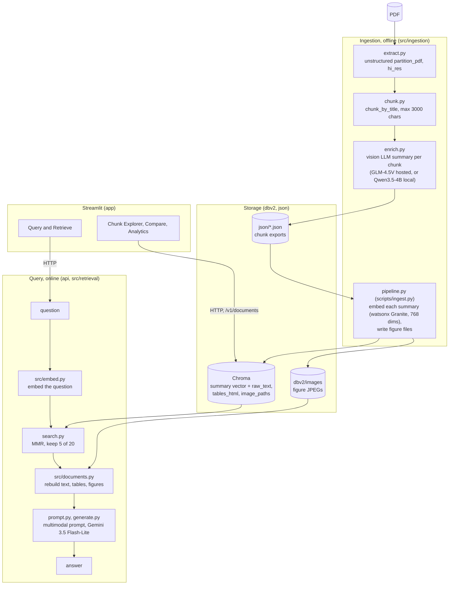

# KI-CRAFT

**An open-source, AI-assisted PCB design and EDA toolkit, built to work alongside KiCad.**

KI-CRAFT aims to bring the same help to open tools: read the datasheets for you, check your schematic against them, and, step by step, draft schematics and assist with layout.

It starts where every design starts: the datasheet. Today it answers questions about datasheets and application notes from their text, tables and figures, and shows the figure each answer relied on.

<div align="center">

[](https://www.python.org/)
[](https://fastapi.tiangolo.com/)
[](https://www.langchain.com/)
[](https://www.trychroma.com/)
[](https://www.ibm.com/watsonx)
[](https://ai.google.dev/)
[](https://streamlit.io/)

</div>

| Chunk Explorer | Dataset Analytics | Query & Retrieve |
|---|---|---|
|  |  |  |

## This branch: the GGUF embedding experiment

This branch (`test/gguf-experiment`) tries running the embedding model on your own computer instead of calling IBM watsonx, so the project works without a watsonx account. Below is everything needed to repeat the experiment, step by step.

### What the experiment is about, in plain words

- To search the datasheets, every piece of text is turned into a list of 768 numbers (an *embedding*). The stored lists in `dbv2/` were made by IBM's model `granite-embedding-278m-multilingual`, running on watsonx.
- A question must be turned into numbers by the *same* model, or the search finds nonsense. So we run that same model locally, from a single file in the GGUF format, with a small C++ program called llama.cpp. No torch, no watsonx key.
- Then we check two things: do the local numbers match the stored ones, and how much memory and CPU does a server need to run it?

### Results you should get

| Check | Q8_0 file (303 MB) | Q4_K_M file (219 MB) |
|---|---|---|
| Match with the stored vectors (cosine, 1.0 = identical) | 0.9999 | 0.991 or higher |
| Same top-5 search results as the original model (12 questions) | 60 of 60 | 58 of 60 |
| Docker image size (the normal watsonx image is 1,104 MB) | 1,761 MB | 1,612 MB |
| Server with 512 MB RAM and 0.1 CPU (like Render's free tier) | killed: out of memory | killed: out of memory |
| Server with 3 GB RAM and 1 CPU (like Cloud Run) | works: peak 635 MB, first answer about 21 s after start, 0.2 to 1.3 s per question | not tested |

### Step 1. Install the tools

You need, once per computer:

- **git**, to download the code.
- **uv**, which installs Python and every package: `curl -LsSf https://astral.sh/uv/install.sh | sh`, then open a new terminal.
- **A C++ compiler and cmake**, because llama.cpp is compiled during installation. On Ubuntu or Debian: `sudo apt install build-essential cmake`. On Fedora: `sudo dnf install gcc-c++ cmake`. On a Mac: `xcode-select --install` and `brew install cmake`.
- **Docker** (only for steps 7 and 8), to test the server image.

### Step 2. Download this branch

```bash
git clone -b test/gguf-experiment https://github.com/amehnd/Ki-Craft.git
cd Ki-Craft
```

The stored vectors and figures (`dbv2/`) come with the clone.

### Step 3. Install the packages

```bash
uv sync --extra local-embeddings
source .venv/bin/activate
```

`--extra local-embeddings` adds llama-cpp-python. It compiles llama.cpp, so this takes a few minutes the first time. Run `source .venv/bin/activate` again in every new terminal.

### Step 4. Download the model file

```bash
python -c "from huggingface_hub import hf_hub_download; hf_hub_download('bartowski/granite-embedding-278m-multilingual-GGUF', 'granite-embedding-278m-multilingual-Q8_0.gguf', revision='61fba13303a369d52a088ccb745be93ecc2034f3', local_dir='models')"
```

This saves a 303 MB file in `models/` (git ignores that folder). The `revision` pins the exact file, so everyone tests the same one. To check the file is intact:

```bash
sha256sum models/granite-embedding-278m-multilingual-Q8_0.gguf
```

It must print `b8b3ebc5f98d179493adf28e6e9e16508766ed85b72cedfbd9bc1540c4905a23`. For the smaller file, use `granite-embedding-278m-multilingual-Q4_K_M.gguf` in the command above; its sha256 is `48985001cb8a2e05539e0c7b52064efbcae732ff08fd1fe391534d30cbd8d942`.

### Step 5. Switch the project to the local model

```bash
cp .env.example .env
```

Open `.env` in any text editor and add this line (no quotes):

```
EMBEDDING_BACKEND=local
```

No watsonx or Gemini key is needed for these steps. To test the Q4_K_M file instead, also add `LOCAL_EMBEDDING_GGUF_PATH=models/granite-embedding-278m-multilingual-Q4_K_M.gguf`.

### Step 6. Check the local numbers match the stored ones

Run the tests first. They use fake models, so they need no download and no network:

```bash
python -m pytest -q -p no:cacheprovider
```

All tests should pass (a few are skipped on purpose).

Now compare the model with the stored vectors. This embeds 50 stored summaries again and compares each with its stored list:

```bash
python -c "
import numpy as np
from src.embed import load_embedding_model
from src.retrieval.search import load_vector_store
model = load_embedding_model()
store = load_vector_store(model)
rows = store.get(limit=50, include=['embeddings', 'documents'])
scores = [float(np.dot(stored, model.embed_query(text))) for stored, text in zip(rows['embeddings'], rows['documents'])]
print('lowest cosine %.4f, average %.4f' % (min(scores), sum(scores) / len(scores)))
"
```

Expected: about `0.9999` for Q8_0, and `0.991` or higher for Q4_K_M. A much lower number would mean the local model does not match the stored vectors.

Then try a real search through the API. Start the server:

```bash
uvicorn api.main:app --port 8001
```

In a second terminal (activate the environment there too):

```bash
curl -s -X POST localhost:8001/v1/retrieve -H 'Content-Type: application/json' -d '{"query": "LM317 reference voltage", "top_k": 5}'
```

You should get 5 chunks, mostly from `lm317`. Stop the server with Ctrl+C.

To check ingestion too, store one document into a scratch folder (this does not touch the real store) and compare it with the stored copy:

```bash
python -m scripts.ingest json/ne555.json --store /tmp/gguf-trial/chroma_db --images /tmp/gguf-trial/images
```

```bash
python -c "
import chromadb, numpy as np
new = chromadb.PersistentClient('/tmp/gguf-trial/chroma_db'); new = new.get_collection(new.list_collections()[0].name)
old = chromadb.PersistentClient('dbv2/chroma_db'); old = old.get_collection(old.list_collections()[0].name)
n = new.get(include=['embeddings', 'documents']); o = old.get(where={'source': 'ne555'}, include=['embeddings', 'documents'])
stored = dict(zip(o['documents'], o['embeddings']))
scores = [float(np.dot(vec, stored[text])) for text, vec in zip(n['documents'], n['embeddings']) if text in stored]
print(len(n['ids']), 'chunks; lowest cosine %.4f' % min(scores))
"
```

Expected: `47 chunks; lowest cosine 0.9999`.

Opening the store rewrites tracked files in `dbv2/chroma_db`. Put them back afterwards:

```bash
git checkout -- dbv2/chroma_db
```

### Step 7. Build the server images with Docker

A Docker *image* is a sealed package of the code plus everything it needs, so it runs the same on any server. Building one means following the recipe in `Dockerfile`.

The normal image (watsonx):

```bash
docker build -t kicraft:watsonx .
```

The local-model image. This compiles llama.cpp and downloads the model inside the build, so the first build takes several minutes:

```bash
docker build --build-arg EMBEDDING_BACKEND=local -t kicraft:gguf-q8 .
```

For Q4_K_M, add `--build-arg GGUF_FILE=granite-embedding-278m-multilingual-Q4_K_M.gguf --build-arg GGUF_SHA256=48985001cb8a2e05539e0c7b52064efbcae732ff08fd1fe391534d30cbd8d942` and tag it `kicraft:gguf-q4`. Compare the sizes:

```bash
docker images | grep kicraft
```

### Step 8. Pretend to be a small server

Docker can limit a container's memory and CPU. These limits copy Render's free tier (512 MB RAM, a tenth of a CPU, no swap):

```bash
docker run -d --name kicraft-test --memory=512m --memory-swap=512m --cpus=0.1 -e LANGSMITH_TRACING=false -p 8000:8000 kicraft:gguf-q8
```

With so little CPU, starting takes a few minutes. Ask until it answers:

```bash
until curl -s -o /dev/null localhost:8000/; do sleep 2; done; echo started
```

Ask a question. The first one loads the model and the store:

```bash
curl -s -X POST localhost:8000/v1/retrieve -H 'Content-Type: application/json' -d '{"query": "LM317 reference voltage", "top_k": 5}' -o /dev/null -w '%{http_code} %{time_total}s\n'
```

Check whether the container ran out of memory:

```bash
docker inspect kicraft-test --format 'OOMKilled={{.State.OOMKilled}}'
```

With 512 MB you should see `000` from curl (no answer) and `OOMKilled=true`. Remove the container:

```bash
docker container rm -f kicraft-test
```

Repeat the same commands with the other two images to see the whole picture:

| Image, under Render's free limits | What happened in our run |
|---|---|
| `kicraft:gguf-q8` | answered `/` after about 3 minutes, then `OOMKilled=true` on the first question |
| `kicraft:gguf-q4` | answered `/` after about 4.5 minutes, then `OOMKilled=true` on the first question (peak exactly 512 MB) |
| `kicraft:watsonx` | answered `/` after about 4.5 minutes, used about 300 MB, returned `503` to the question (expected: no watsonx key) and was not killed |

The watsonx run shows the API itself already needs about 300 MB, which leaves too little of the 512 MB for a local model. Start-up times vary by a minute or so between runs, because a tenth of a CPU is very slow.

Now repeat with a server like Cloud Run (3 GB RAM, 1 CPU): run the same commands, but start the container with `--memory=3g --memory-swap=3g --cpus=1`. This time the question should return `200` in under about 2 seconds. While it runs, see how much memory it uses at most:

```bash
docker exec kicraft-test cat /sys/fs/cgroup/memory.peak
```

That prints bytes; about `665000000` (635 MB) is expected. To test several questions at once, run the curl command five times in parallel by ending each line with `&`, then `wait`. All five should return `200`.

Remove the container when done:

```bash
docker container rm -f kicraft-test
```

### Words used above

| Word | Meaning |
|---|---|
| Embedding | a list of 768 numbers that stands for the meaning of a text |
| Cosine | how alike two embeddings are; 1.0 means the same |
| GGUF | a single-file format for model weights, run by llama.cpp |
| Q8_0, Q4_K_M | smaller versions of the model (8 and about 4.5 bits per number); smaller drifts a little more |
| Image | a sealed package of the program and everything it needs |
| Container | a running copy of an image |
| OOMKilled | the container used more memory than allowed and was stopped |
| vCPU | a share of one processor core |

## Who it is for

- **KiCad users tired of drawing schematics by hand** and cross-checking every pin, capacitor value and footnote against a 60-page PDF.
- **Hardware engineers** checking a design: dropout at a given load, the output voltage formula, the recommended layout, with the source figure to verify against.
- **Students and makers** learning to read datasheets: what a pin does, "typical" versus "maximum", what a graph shows.
- **Teams who want an open alternative** to closed AI EDA tools, one they can run, inspect and extend.

## Status

| Phase | Goal | Progress |
|---|---|---|
| 1. Datasheet assistant | Trustworthy answers from datasheets: text, tables, figures, cited | `████░░░░░░` 40%, in progress |
| 2. Schematic review | Check a KiCad schematic against the datasheets of its parts: pins, feedback dividers, decoupling | `░░░░░░░░░░` planned |
| 3. Design agent | Draft schematics in KiCad from requirements, and assist with placement and layout | `░░░░░░░░░░` planned |

Phase 1 so far: a cleaned-up, explainable codebase, an API with streaming answers and labelled figure citations, and a pipeline that ingests any PDF. Next: an evaluation set that measures accuracy, Postgres with hybrid search, uploading your own PDFs through the API with page-level citations, and a hosted demo.

## What it does today

- **Answers from text, tables and figures.** The model gets each relevant section's original text, its tables and its figures, not just the paragraphs.
- **Shows its evidence.** Every answer lists the figures the model saw, and cites them as `[IMG1]`, `[IMG2]`, next to the chunks it used (`[C1]`).
- **Refuses to guess.** It says when the documents do not state something, keeps units and test conditions, and never mixes values from different parts.
- **Brings your own model.** Gemini by default; any model from Gemini, OpenAI, Groq or Hugging Face with your own key.
- **Ingests new PDFs** with a hosted vision model or one that runs locally on a Mac.

Six datasheets and application notes ship ready to query: LM317, LM2596, LM555, NE555, TLV1117 and Microchip AN699.

<details>
<summary><b>How it works</b></summary>

A vision model writes a plain-text summary of each section of a PDF, covering its prose, tables and figures. The summaries are embedded and searched; the original text, tables and figures are stored alongside, so each answer is written from the source material, not from the summary.



</details>

## Getting started

Setup, running the API and the dashboard, ingesting your own PDFs and Docker are covered in [CONTRIBUTING.md](CONTRIBUTING.md).

## Documentation

| Document | What it holds |
|---|---|
| [CONTRIBUTING.md](CONTRIBUTING.md) | Setup, running each part, ingestion, Docker, configuration, and conventions for changes |
| [docs/TRADEOFFS.md](docs/TRADEOFFS.md) | Why each component is built the way it is, and what was considered instead |
| [docs/PRODUCT_RESEARCH.md](docs/PRODUCT_RESEARCH.md) | What people designing with datasheets need, existing tools, and where this project can stand out |

## Contributing

Issues and pull requests are welcome. Start with [CONTRIBUTING.md](CONTRIBUTING.md), or open a [GitHub issue](https://github.com/moksh-m9u/Multimodal-Rag/issues) to discuss an idea.

## License

[Apache 2.0](LICENSE)
